# Alya 智能翻译助手软件 V1.0 — 软件说明书

> 本文档为 Alya 软件的正式用户手册，适用于软件著作权登记（作为“文档”材料）及产品交付说明。
> 软件版本：V1.0.0 ｜ 运行平台：Windows 10 1809+ / Windows 11（64 位）

---

## 第一章 软件概述

### 1.1 软件简介
Alya 智能翻译助手软件（以下简称“本软件”或“Alya”）是一款运行于 Windows 桌面操作系统的常驻型智能翻译工具。本软件以系统托盘方式常驻后台，通过全局快捷键在任意前台程序中即时提供翻译服务，用户无需切换应用或复制粘贴即可获得译文。

本软件采用“自带密钥”（BYOK，Bring Your Own Key）模式接入人工智能翻译服务：用户自行配置兼容 OpenAI 协议的第三方 API 服务与密钥，本软件不设中转服务器、不收取 API 费用、不保存翻译历史。

### 1.2 主要功能
1. **划词翻译**：在任意应用中选中文字后按快捷键，浮动面板自动弹出并返回译文；
2. **输入翻译**：呼出输入面板，手动输入或粘贴文本后进行翻译，支持自动翻译（输入停顿后自动触发）；
3. **剪贴板监听翻译**（可选）：监听系统剪贴板，复制新内容后自动翻译；
4. **截图识别**：框选屏幕任意区域，在本机完成文字识别（OCR），输出可编辑文本；
5. **截图翻译**：框选屏幕任意区域，本机识别后自动翻译，适用于字幕、游戏界面、图片、扫描件等无法选中文字的场合；
6. **互译 / 定向双场景**：互译场景自动判断翻译方向；定向场景固定输出至指定目标语言，并支持运行中切换目标语言即时重译；
7. **译文呈现双模式**：全部流式输出（逐字显示）与分档呈现（长文等待完整结果后整段显示，附预估剩余时间）；
8. **面板几何记忆**：记忆面板位置、窗口尺寸与原文输入框高度；译文区高度随内容自动展开；
9. **九语种界面**：简体中文、繁体中文、英语、日语、韩语、法语、德语、西班牙语、俄语；
10. **主题切换**：亮色 / 暗色 / 跟随系统，含原生窗口标题栏深浅联动。

### 1.3 软件特点
- 全局可用：任何前台程序中均可用快捷键唤起，不打断当前工作流；
- 隐私优先：截图识别全程在本机完成，截图图像不外传，仅识别出的文字发送至用户配置的服务；
- 本地加密：API 密钥采用 Windows DPAPI 加密存储，界面不回显；
- 无账号无遥测：本软件不设账号体系，不含任何数据统计或行为上报模块；
- 适应性强：支持多显示器与高 DPI 缩放环境，面板在工作区内自动避让，不越屏。

---

## 第二章 运行环境

### 2.1 硬件环境
| 项目 | 要求 |
|---|---|
| 处理器 | x64 架构处理器（Intel / AMD 均可） |
| 内存 | 建议 4 GB 及以上 |
| 硬盘空间 | 约 60 MB 可用空间（另需少量空间存放配置与日志） |
| 显示器 | 任意分辨率；支持多显示器与 100%~200% 缩放 |

### 2.2 软件环境
| 项目 | 要求 |
|---|---|
| 操作系统 | Windows 10 版本 1809（内部版本 17763）及以上 / Windows 11 |
| 运行时依赖 | Microsoft Edge WebView2 Runtime（Windows 11 内置；Windows 10 一般随系统更新存在） |
| 网络 | 翻译功能需要网络连接（连接用户自行配置的 API 服务）；截图识别可离线使用 |
| 其他依赖 | 无（无需 .NET、无需 Java 等外部运行库） |

---

## 第三章 安装与启动

### 3.1 安装
本软件提供两种分发形态：
- **安装包**：运行安装程序，按提示完成安装（支持 Microsoft Store 分发，由商店自动完成安装与更新）；
- **便携版**：解压压缩包至任意目录，直接运行其中的 `Alya.exe`，无需安装。

### 3.2 首次启动
首次启动时显示四步配置引导：

1. **欢迎**：软件简介与快捷键速览；
2. **隐私告知**：说明翻译文本的发送范围与截图识别的本地处理方式；
3. **配置 AI 服务**：填写“接口地址 / 模型名 / API Key”三项。本软件支持任意兼容 OpenAI 协议的 API 服务（默认填入 DeepSeek 官方地址与模型），可点击“验证连接”当场校验配置是否可用；本步骤可跳过，稍后在设置中补配；
4. **完成**：显示常用快捷键清单，进入软件主界面（常驻托盘）。

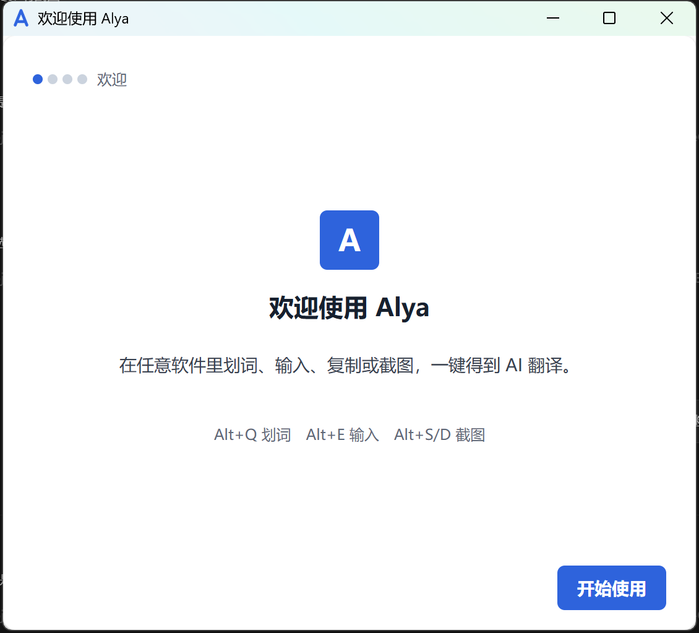
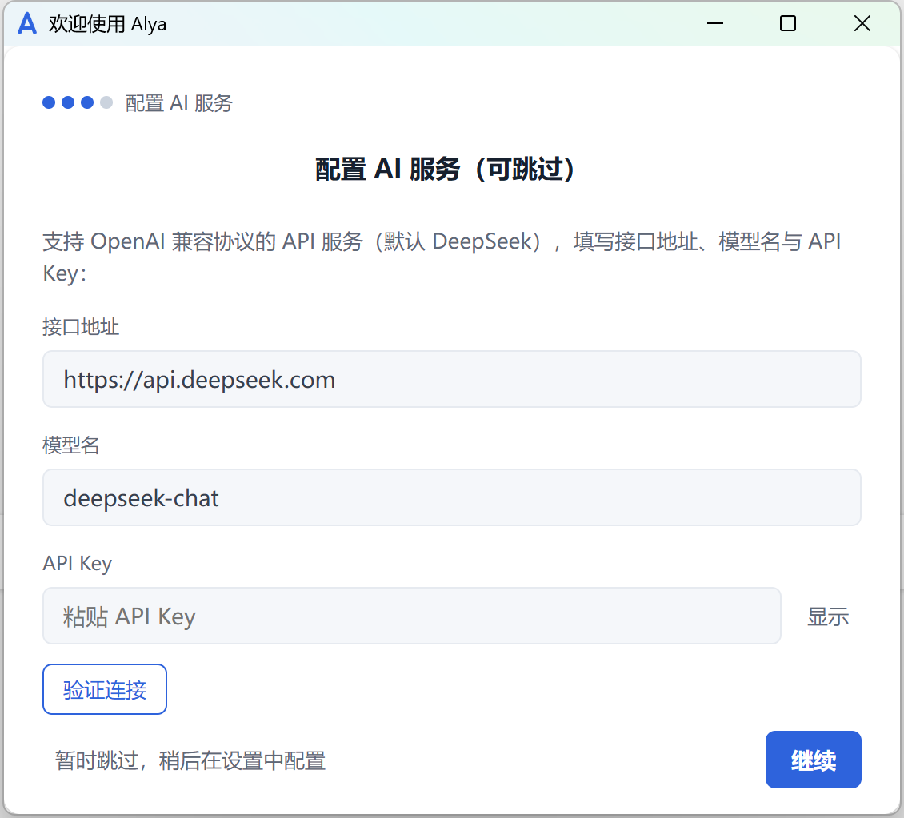

### 3.3 启动与常驻
启动后本软件常驻系统托盘（通知区域），主窗口默认隐藏。托盘图标操作：
- **左键单击**：呼出输入翻译面板；
- **右键单击**：打开功能菜单（当前场景、输入翻译、截图识别、截图翻译、剪贴板监听、设置、退出）。

---

## 第四章 功能操作说明

### 4.1 全局快捷键
| 快捷键（默认） | 功能 | 操作说明 |
|---|---|---|
| `Alt+Q` | 划词翻译 | 在任意应用中选中文本后按下，面板于光标附近弹出并自动翻译 |
| `Alt+E` | 输入翻译 | 呼出输入面板；输入或粘贴文本后按 `Enter` 翻译（开启自动翻译时停顿即自动翻译） |
| `Alt+S` | 截图识别 | 屏幕进入框选状态，拖出矩形后本机识别文字 |
| `Alt+D` | 截图翻译 | 同截图识别，识别完成后自动翻译 |
| `Alt+W` | 切换场景 | 在“互译”与“定向”之间切换 |

> 全部快捷键均支持修改：设置 → 快捷键，点击“修改”后直接按下新组合键即可录入。若新组合与其他程序冲突，软件会自动回退为原快捷键并在设置页给出提示。

### 4.2 输入翻译（Alt+E）
1. 按下 `Alt+E`，面板弹出且光标定位于输入框；
2. 输入或粘贴待翻译文本；
3. 开启“自动翻译”时，输入停顿达到设定延迟后自动翻译；未开启时按 `Enter` 翻译；
4. `Shift+Enter` 输入换行；
5. 修改原文后，右下角出现“重译 ↵”按钮，点击或按 `Enter` 重新翻译。

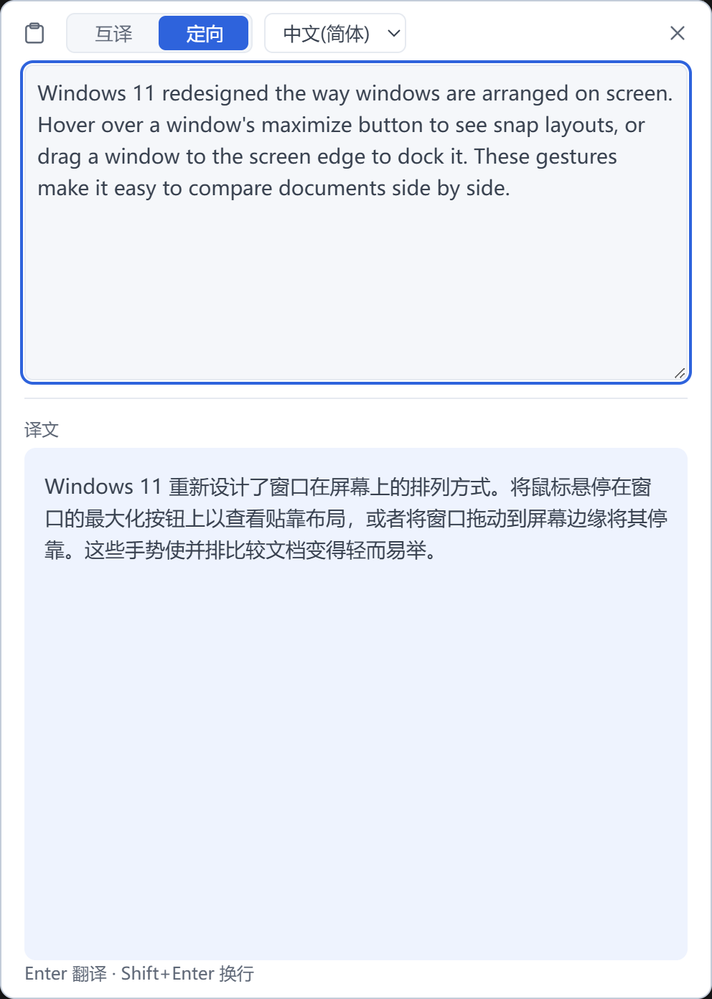

### 4.3 划词翻译（Alt+Q）
1. 在任意应用中用鼠标选中文本；
2. 按下 `Alt+Q`；
3. 面板弹出，原文显示在上方，译文流式出现在下方；原文可继续编辑并重译。

### 4.4 剪贴板监听（可选）
1. 点击面板顶栏左侧的剪贴板图标（或托盘菜单中的“剪贴板监听”）开启；
2. 此后每次复制新的文本内容，面板将自动弹出并翻译；
3. 再次点击图标即可关闭。该功能与面板开关、托盘勾选三处状态实时同步。

### 4.5 截图识别与截图翻译（Alt+S / Alt+D）
1. 按下快捷键后，屏幕进入框选状态（画面变暗，屏幕顶部显示提示「拖拽选择区域 · Esc 取消」，随界面语言切换）；
2. 按住鼠标左键拖出矩形框，覆盖需要识别的文字区域；
3. 松开鼠标后，本机立即进行文字识别（Windows 系统 OCR 引擎，离线完成）；
4. 截图识别（Alt+S）：面板显示可编辑的识别文本，可切换识别语种重新识别，或点击“送翻译”转为翻译；
5. 截图翻译（Alt+D）：识别完成后自动翻译，面板同时显示识别原文与译文。
6. 识别文本会自动规整：跨行断开的单词合并、连字符与破折号归一、中文段落间的软换行合并，避免多余空格影响译文。

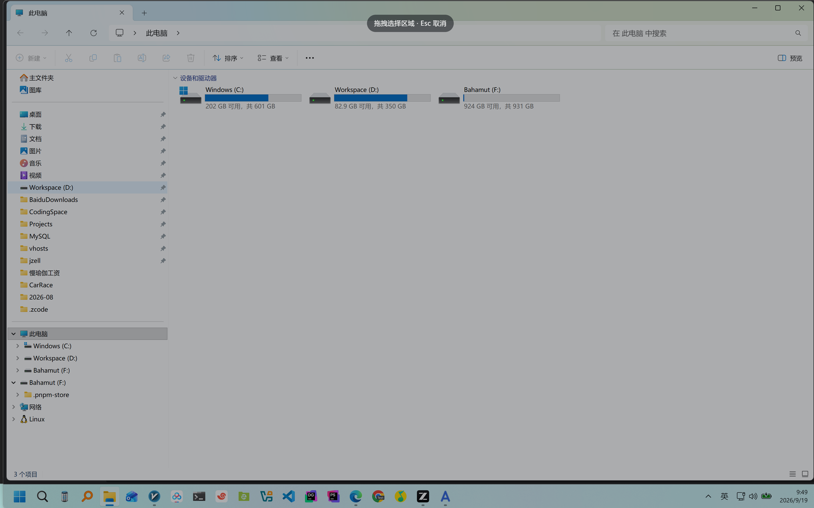
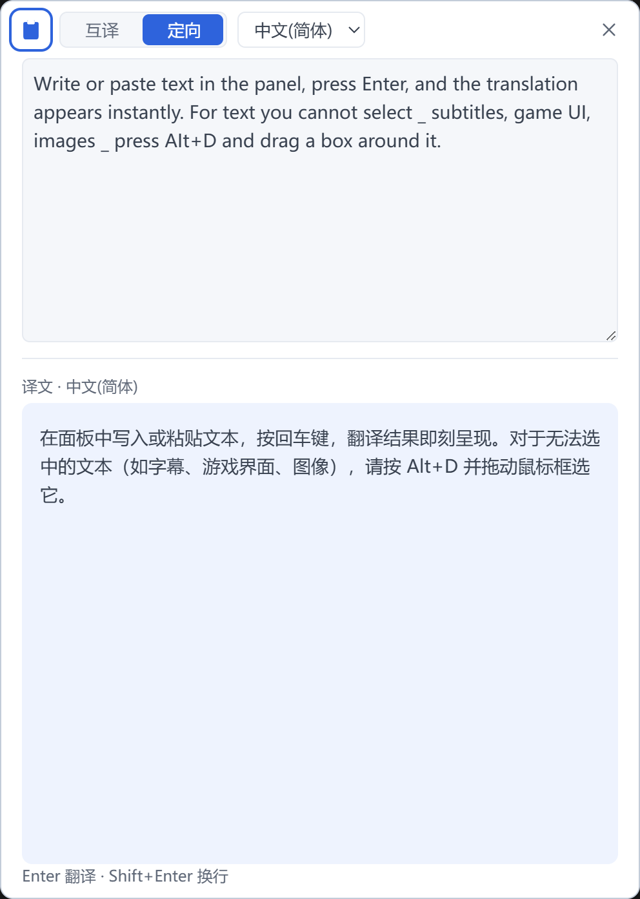

> 隐私说明：截图图像仅存于内存，不写入磁盘、不上传网络；仅识别出的文字被发送至用户配置的翻译服务。

### 4.6 互译与定向场景
- **互译**：软件自动判断翻译方向（例如中文↔英文互相翻译），适合日常阅读；
- **定向**：固定输出为用户指定的目标语言（在面板顶栏下拉选择）；原文有内容时切换目标语言，软件会立即按新语言重新翻译；
- 场景切换：按下 `Alt+W`，或点击面板顶栏的“互译 / 定向”分段控件。

### 4.7 面板操作细则
- **移动**：按住面板顶栏拖动；
- **调整窗口大小**：拖动窗口边缘；
- **调整输入框高度**：拖动输入框右下角；调整后的高度会被记忆；
- **关闭**：点击顶栏“×”或按 `Esc`（`Esc` 同时中止进行中的翻译）；
- **失焦即隐**：面板失去焦点时自动隐藏（可在设置中关闭该行为）。

### 4.8 主题与语言
- 主题：设置 → 通用 → 主题（跟随系统 / 亮色 / 暗色），切换即时作用于所有窗口；
- 界面语言：设置 → 通用 → 语言，内置九种语言，默认跟随系统语言。

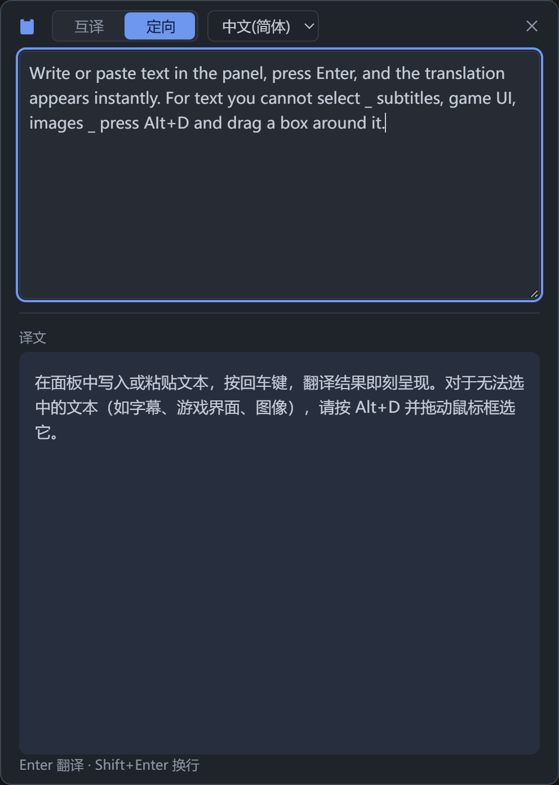

---

## 第五章 设置说明

设置窗口包含六个分组：

### 5.1 AI 服务
| 项目 | 说明 |
|---|---|
| 接口地址 | 兼容 OpenAI 协议的 API 基础地址 |
| 模型名 | 服务商提供的模型标识（如 deepseek-chat） |
| API Key | 密钥。本地加密存储，界面仅显示“已配置/未配置”；“修改”后可重新录入，留空保存即清除 |
| 验证连接 | 一键实测当前已保存配置的连通性；密钥编辑过程中不可用（验证的是已保存的配置），结果行内显示成功或失败原因 |

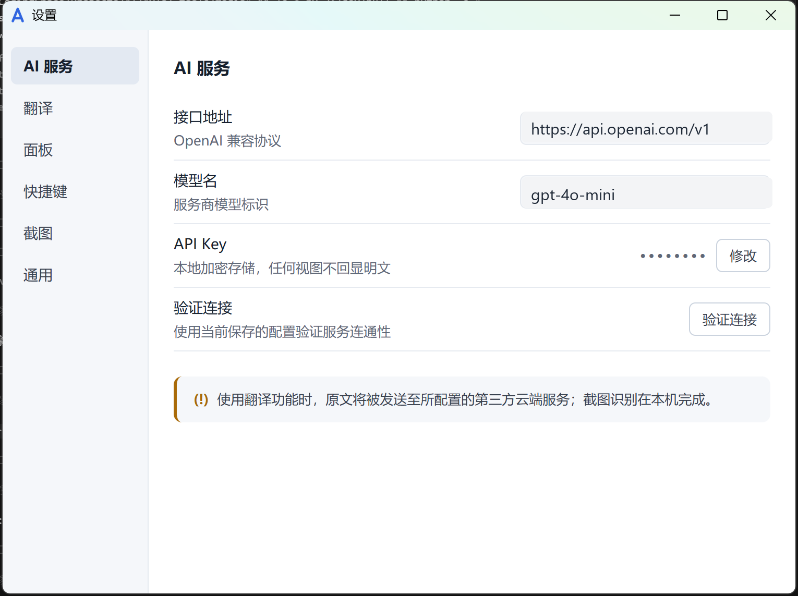

### 5.2 翻译
| 项目 | 说明 |
|---|---|
| 定向目标语言 | 定向场景的默认目标语言；面板内临时切换不回写此默认值 |
| 译文呈现 | “全部流式”（逐字显示）或“分档呈现”（长文完整后整段显示） |
| 长文整段阈值 | 仅分档呈现生效；超过该字符数的原文按整段模式处理（默认 1000） |
| 自动翻译 | 开关；开启后原文输入/修改停顿即自动翻译 |
| 自动翻译延迟 | 打字停顿判定时长（0.3 / 0.5 / 0.7 / 1 / 1.5 / 2 秒） |

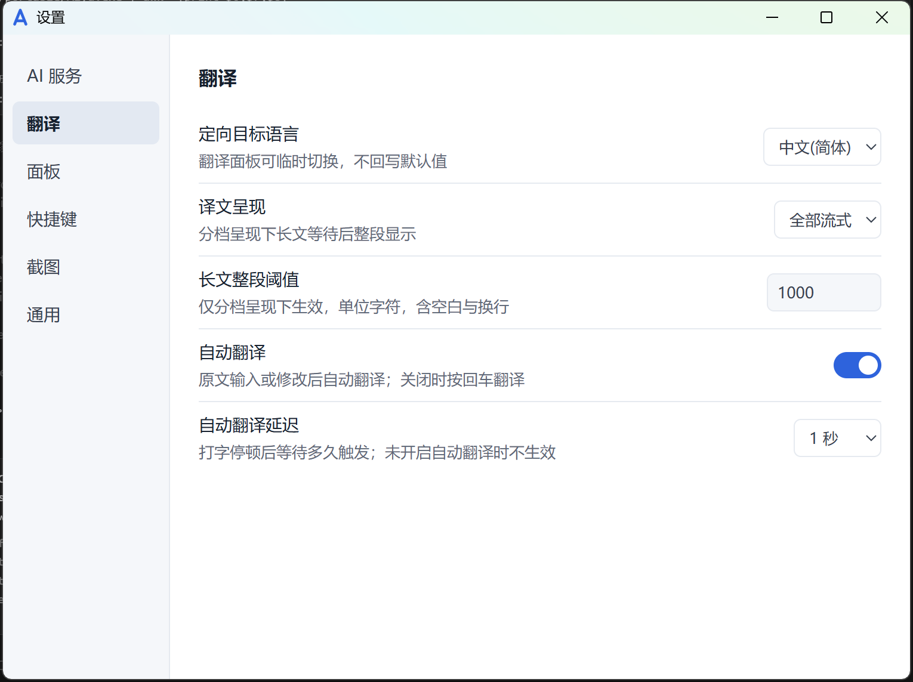

### 5.3 面板
| 项目 | 说明 |
|---|---|
| 失焦即隐 | 面板失去焦点即隐藏；关闭后需手动关闭 |
| 剪贴板监听 | 与面板顶栏开关、托盘勾选三方同步 |

### 5.4 快捷键
五项功能的录制式改键（划词翻译 / 输入翻译 / 截图识别 / 截图翻译 / 切换场景）。启动时若有快捷键被系统或其他程序占用，对应行会显示警告图标，点击即可重新录制。

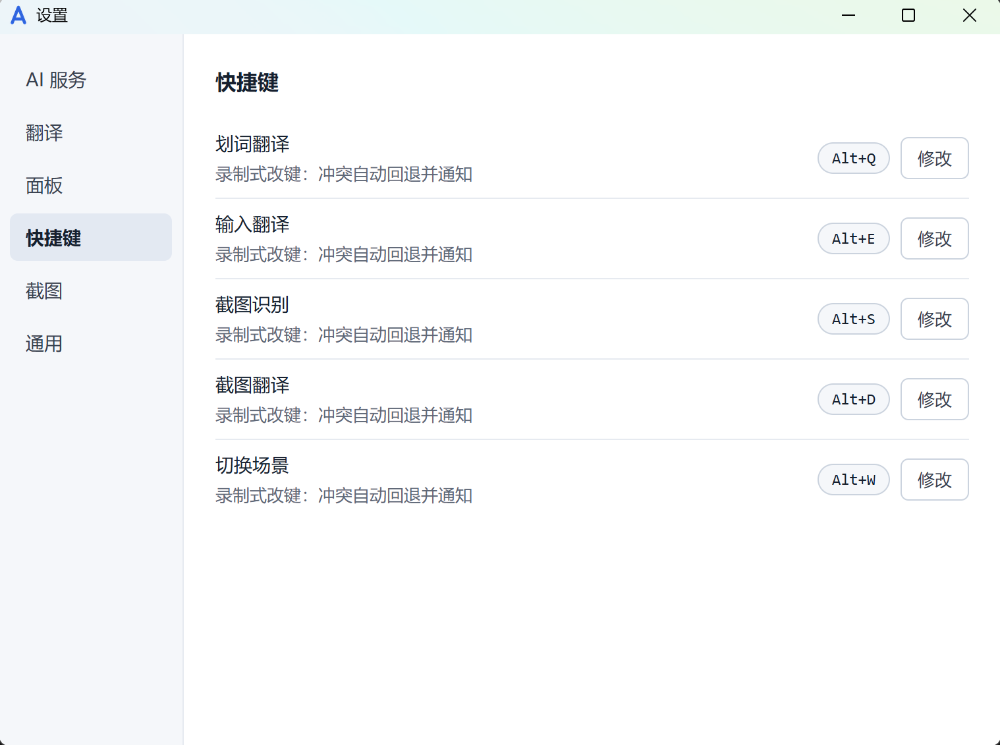

### 5.5 截图
| 项目 | 说明 |
|---|---|
| OCR 语种 | “自动”跟随系统首选语言；也可指定语种（需系统已安装对应语言包，缺失时给出安装指引） |

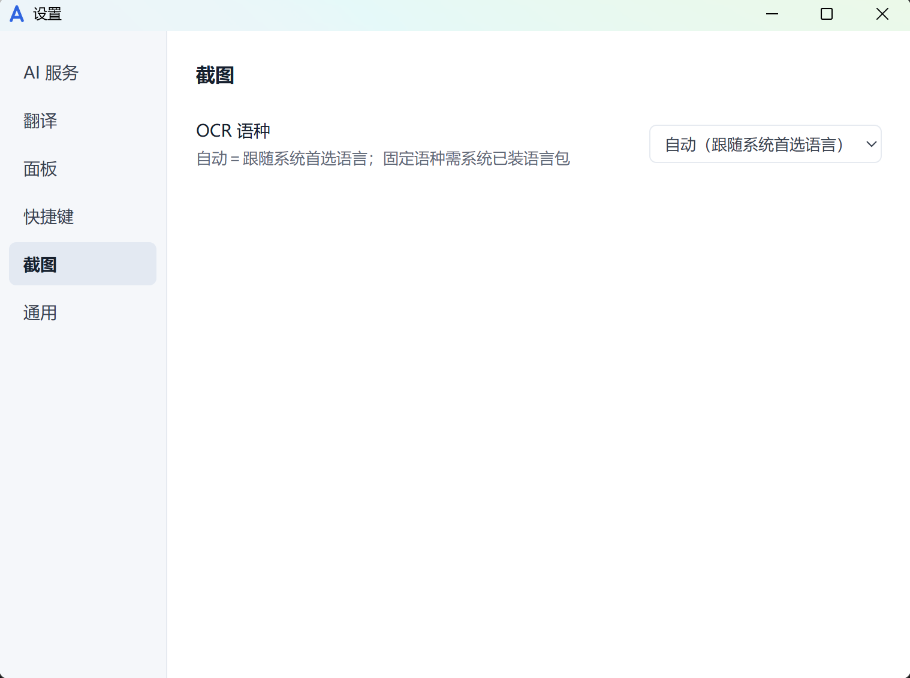

### 5.6 通用
| 项目 | 说明 |
|---|---|
| 开机自启 | 开机后自动启动并驻留托盘 |
| 语言 | 九种界面语言，默认跟随系统 |
| 主题 | 亮色 / 暗色 / 跟随系统 |
| 恢复默认设置 | 将全部设置还原为出厂默认；执行前二次确认；**保留** API Key、引导完成状态与界面语言 |

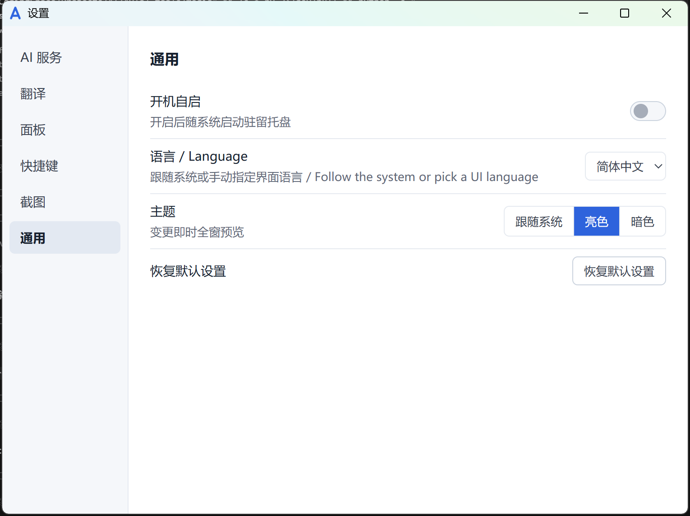

---

## 第六章 常见问题

**Q1：面板提示“鉴权失败，请检查 API Key”怎么办？**
在设置 → AI 服务中确认接口地址、模型名与密钥是否正确；可先在该服务商控制台确认密钥状态与余额。错误卡片中的“打开设置”按钮可直达对应设置页。

**Q2：截图翻译提示缺少 OCR 语言包？**
Windows 的文字识别能力由系统语言包提供。请在“设置 → 时间和语言 → 语言和区域”中为目标语言安装“基本输入/光学字符识别”组件，或改用“自动”语种。软件在错误提示中附有微软官方指引链接。

**Q3：快捷键按下没有反应？**
可能有其他程序占用了同一组合。请到 设置 → 快捷键 重新录制；软件启动时如检测到冲突，会在对应行显示警告图标。

**Q4：翻译内容会被上传到哪里？**
仅发送至你在“AI 服务”中配置的第三方服务商；本软件不含自建服务器。截图识别在本机完成，截图图像不外传。详见《隐私政策》。

**Q5：更换电脑后如何迁移配置？**
复制 `%APPDATA%\com.alya.app\config.json` 至新电脑同路径即可（API Key 为 Windows 账户级加密，换机后需重新录入密钥）。

**Q6：设置改乱了想一键还原怎么办？**
设置 → 通用 → 恢复默认设置：二次确认后将全部设置还原为出厂默认，API Key、引导完成状态与界面语言会被保留，无需重新配置服务。

**Q7：改了接口地址或密钥，怎么确认能用？**
设置 → AI 服务 → 验证连接，直接实测当前已保存的配置并在行内给出结果（成功 / 失败原因），无需先做一次真实翻译。

**Q8：长文翻译为什么要等一会儿才整段出现？**
“分档呈现”模式会等待完整译文后整段显示，避免逐字跳动的阅读干扰，并显示预估剩余时间；如需实时查看，可在设置 → 翻译中切换为“全部流式”。

---

## 附录 A 目录与文件说明

| 路径 | 内容 |
|---|---|
| `%APPDATA%\com.alya.app\config.json` | 全部设置（含加密后的 API 密钥） |
| `%LOCALAPPDATA%\com.alya.app\logs\` | 本地运行日志（诊断用，仅存本机） |
| `%APPDATA%\com.alya.app\instance.pid` | 单实例运行标记 |

## 附录 B 本版本功能对照

| 功能 | V1.0.0 |
|---|---|
| 划词 / 输入 / 剪贴板 / 截图 四种翻译入口 | ✅ |
| 互译 / 定向双场景 + 目标语言即时切换重译 | ✅ |
| 流式 / 分档呈现 + 长文预估计时 | ✅ |
| 本机 OCR（截图不外传） | ✅ |
| 面板位置 / 尺寸 / 输入框高度记忆 | ✅ |
| 多显示器与高 DPI 适配 | ✅ |
| 九语种界面 + 主题跟随系统 | ✅ |
| 热键冲突自愈与录制改键 | ✅ |
| 设置页验证连接 / 恢复默认设置 | ✅ |
| 识别文本自动规整（断词/换行/符号） | ✅ |
| 框选遮罩屏上提示（九语） | ✅ |

---

*说明书结束。界面截图取自 V1.0.0 实际运行环境；截图中 API 地址与模型名为示例值。*
