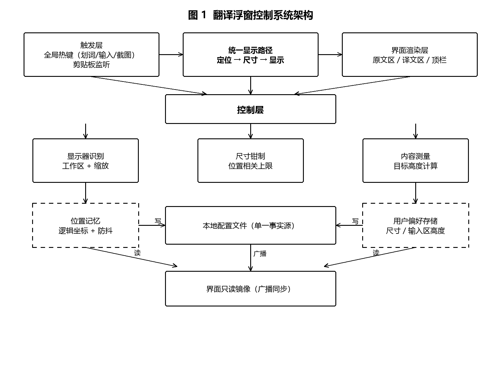
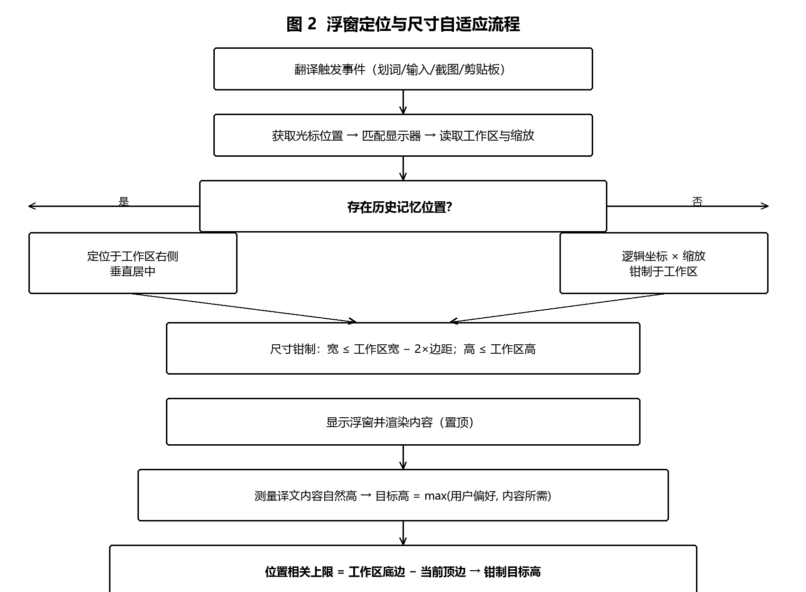
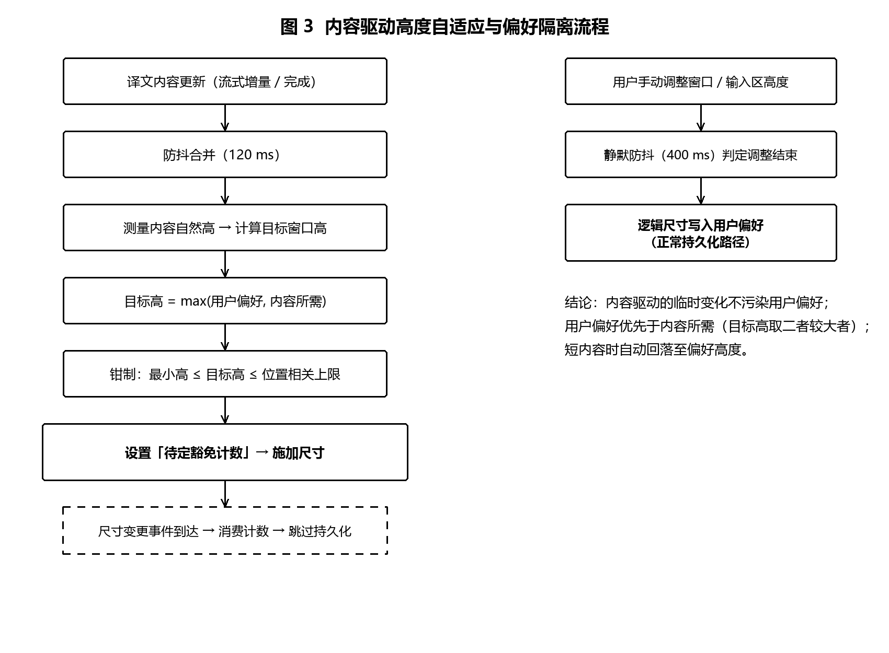
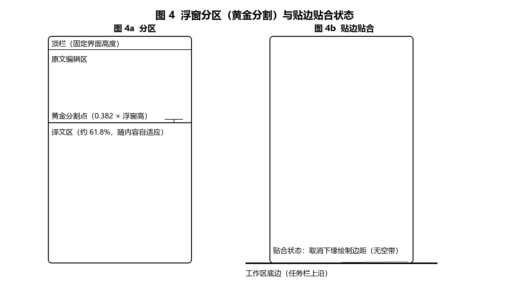

# 专利技术交底书

**发明名称（建议）**：一种翻译浮窗的自适应定位与尺寸控制方法及装置
**申请人**：`<待填：申请人/单位>`
**发明人**：`<待填>`
**技术领域**：计算机软件与图形用户界面技术领域，具体涉及桌面浮窗（面板）在多变显示环境下的自动定位与尺寸自适应控制。
**拟申请类型**：发明专利

---

## 一、背景技术

桌面翻译类工具普遍以浮窗（浮动面板）形式在屏幕上显示原文与译文。现有技术方案通常存在以下问题：

1. **定位问题**：浮窗多以固定规则出现（屏幕居中、固定角落或跟随鼠标偏移固定像素）。当光标靠近屏幕边缘、任务栏停靠位置不同（底部/顶部/左右）、或使用多显示器（含负坐标副屏）时，浮窗常越出工作区、被任务栏遮挡，用户必须手动拖回。
2. **尺寸问题**：浮窗高度多为固定值或简单上限值。译文内容较长时，用户需要频繁滚动；用户手动调整尺寸后，该尺寸或被内容变化覆盖，或在下次呼出时丢失；长文内容驱动的高度变化若直接持久化，会使浮窗被"上次的长文"永久撑大，短内容时房间空置占屏。
3. **多显示器与高 DPI 问题**：不同显示器具有不同缩放比例（DPI），以物理像素存储窗口尺寸会导致跨屏迁移后尺寸漂移；缩放变更亦会造成尺寸跳变。
4. **贴边视觉问题**：浮窗贴近屏幕底部（任务栏上沿）时，窗口下缘的阴影绘制边距会产生一条可见"空带"；若为消除该空带而简单去除圆角又造成视觉突兀。
5. **原文/译文分区问题**：原文输入区与译文显示区共享浮窗高度，长原文会将译文区挤压至不可读，且输入区高度随内容无限增长。

上述问题共同导致：浮窗"不听话"——位置要重摆、尺寸要重调、越屏与被遮挡频发，直接劣化阅读与输入体验。

---

## 二、发明要解决的技术问题

提供一种翻译浮窗的自适应定位与尺寸控制方法，使浮窗在任意光标位置、任意任务栏配置、多显示器与混合 DPI 环境下：

1. 自动出现在不越出工作区、不被任务栏遮挡的位置；
2. 窗口高度在"内容所需"与"用户偏好"之间自动权衡，长文自动展开、短内容自动回落；
3. 用户的手动调整（位置/尺寸/输入区高度）被可靠记忆，且不被内容驱动的临时变化覆盖；
4. 贴边时获得无空带的贴合视觉；
5. 原文区与译文区比例合理，长文不挤压阅读区。

---

## 三、技术方案

### 3.1 总体流程

```
捕获触发（划词/输入/截图/剪贴板）
        │
        ▼
① 定位阶段：取光标所在显示器 → 记忆位置存在？
     ├─ 是：逻辑记忆位置 × 该屏缩放 → 工作区钳制 → 落位
     └─ 否：默认贴工作区右侧、垂直居中
        │
        ▼
② 尺寸阶段：偏好尺寸 × 所在屏缩放 → 工作区上限钳制（宽=工作区宽−2×边距；高=工作区高）
        │
        ▼
③ 显示阶段：置顶显示 + 内容渲染
        │
        ▼
④ 内容自适应阶段：测量译文内容自然高度 → 目标窗口高 = max(用户偏好, 内容所需)
     → 以"窗口顶边位置"为基准推导高度上限（工作区底 − 顶边）
     → 超出上限则钳制；放不下则底边钉住、顶边上移（等效向上生长）
     → 程序化变更不持久化（计数豁免）
        │
        ▼
⑤ 交互阶段：用户拖动 → 防抖（静默 N ms）后持久化逻辑位置/尺寸/输入区高度
```

### 3.2 关键技术特征

**特征 A：基于光标锚点的溢出翻转定位**
以光标物理坐标为锚点，候选位置为锚点偏移（如 +16,+16 逻辑像素）；若候选位置右溢出则整体翻转至锚点左侧，下溢出则翻转至锚点上方，角部溢出双轴同时翻转；翻转后仍溢出则以工作区安全边距钳制。

**特征 B：位置记忆与程序化复位豁免**
用户拖动或系统磁吸导致窗口移动时，经防抖（Moved 事件静默 400 ms）持久化**逻辑像素**位置；程序化定位（呼出复位、尺寸自适应引起的坐标修正）通过**待定豁免计数**标记，对应移动事件被消费而不写回记忆，从而保证"程序化复位不会覆盖用户选择的位置"。

**特征 C：位置相关的高度上限**
高度上限不再采用固定比例（如工作区 80%），而是按**窗口顶边当前位置**现场推导：`上限 = 工作区底边 − 窗口顶边`。由此，窗口贴工作区顶时允许整工作区高度（磁吸到屏幕边界即为最大），窗口靠下时上限自然收紧，保证任何情况下不越出工作区。定位阶段的 y 轴下界放宽至工作区顶（允许满高窗口贴顶），底边钳制放宽至工作区底边（允许贴底）。

**特征 D：内容驱动的高度自适应与偏好隔离**
a) 前端测量译文内容自然高度，换算为"不滚动所需窗口总高"；
b) 目标高度 = `clamp(max(用户偏好高度, 内容所需高度), 最小高度, 位置相关上限)`；
c) 窗口贴底时**底边钉住、顶边上移**（等效向上生长），而非简单向下扩张导致越界；
d) **程序化尺寸变更通过待定计数豁免持久化**——长文导致的临时增长不写入用户偏好，短内容时自动回落至偏好高度；
e) 呼出时以偏好尺寸复位，保证每次呼出的初始形态可预期。

**特征 E：贴边贴合渲染**
前端按"窗口底边是否贴住工作区底边"判定贴合状态；贴合时取消窗口内部的下缘绘制边距（阴影环），保留圆角，使卡片视觉上直接压在工作区底边（任务栏上沿）而无可见空带。

**特征 F：原文/译文黄金分割分区**
原文编辑区高度固定为 `窗口高 × 0.382 − 上方固定 chrome 高度`（chrome 含边框、内环、顶栏等常量），其底边恰落在窗口高度的黄金分割点；译文区占其余约 61.8% 并随内容自适应。用户拖动原文区高度后，该高度作为用户偏好持久化并优先于黄金分割比例。

### 3.3 关键参数（实施例）

| 参数 | 取值（实施例） | 作用 |
|---|---|---|
| 锚点偏移 | 16 逻辑像素 | 浮窗与光标的呼吸间距 |
| 工作区安全边距 | 8 逻辑像素（顶/左右；底边 0） | 不越界、贴底磁吸 |
| 位置持久化防抖 | 400 ms | 区分"拖动中"与"拖动结束" |
| 尺寸/内容自适应防抖 | 120 ms | 流式输出期间合并测量 |
| 最小尺寸 | 380×300 逻辑像素 | 可读性下限 |
| 黄金分割系数 | 0.382 | 原文区上限，译文区占 61.8% |
| 输入区高度合法范围 | 56~5000 逻辑像素 | 防止异常值压扁/撑爆 |

---

## 四、有益效果

1. 浮窗在任意光标位置、任意任务栏配置、多显示器与混合 DPI 环境下**不越出工作区、不被任务栏遮挡**；
2. 长文自动展开阅读区、短内容自动回落，**阅读滚动显著减少且不浪费屏幕**；
3. 用户的位置/尺寸/输入区高度调整被可靠记忆，**程序化行为不会覆盖用户偏好**；
4. 贴边时视觉无缝（无空带、圆角保留），**兼顾美观与"填满"的心理预期**；
5. 原文与译文以黄金分割分区，**长原文不再挤压译文阅读区**；
6. 全部判定以逻辑像素与运行时工作区数据为基准，**跨显示器、跨缩放一致**。

---

## 五、具体实施方式（要点）

- **触发入口**：全局热键（划词/输入/截图）与剪贴板监听，任一入口均经统一显示路径；
- **显示器识别**：以光标位置匹配显示器（含负坐标副屏），取该显示器工作区（已排除任务栏）与缩放系数；
- **尺寸换算**：配置以逻辑像素存储；物理尺寸 = 逻辑尺寸 × 所在屏缩放，四舍五入；
- **窗口约束**：窗口管理器最小尺寸约束 + 应用层钳制双保险；
- **内容测量**：以译文滚动容器的子元素几何高度之和加内边距作为内容自然高度；未滚动状态下亦可据此收缩；
- **用户调整采集**：文本输入控件可纵向拖拽，拖拽结束采样高度并防抖持久化；
- **持久化路径**：位置、尺寸、输入区高度均写入本地配置（单一事实源），界面经广播事件同步为只读镜像；
- **异常处理**：显示器信息缺失时仅做最小尺寸约束；持久化失败仅记录不阻断交互。

---

## 六、可替代方案

1. 锚点偏移量、安全边距、防抖时长、黄金分割系数均可按设计需要调整；
2. 记忆位置可扩展为"多位置槽位"（按触发入口分别记忆）或"按显示器分别记忆"；
3. 内容自适应可由"译文高度"推广至任意内容区（如代码预览、表格）的自适应；
4. 位置相关上限可推广为任意"贴边吸附"窗口的尺寸约束（非翻译场景的浮窗、工具面板）；
5. 贴边贴合渲染可推广至任意四边（当前实施于底边）。

---

## 七、检索与新颖性自查（初步）

- 现有公开技术中，桌面浮窗多为固定位置规则 + 固定尺寸上限（如工作区百分比），未见"**位置相关的高度上限**（上限 = 工作区底 − 当前顶边）"与"**内容驱动临时尺寸不污染用户偏好**（程序化变更豁免计数）"的组合方案；
- 建议代理人重点检索：`桌面浮窗 自适应 尺寸`、`窗口 吸附 工作区`、`翻译 浮窗 定位`、`content-driven window sizing`、`magnetic docking window` 等中英文关键词。

---

## 八、附：本申请可一并评估的关联技术点（可拆分另案）

### 关联点 1：一种基于本机文字识别与云端翻译协同的隐私保护翻译方法
- 技术问题：截图翻译需上传图片，存在隐私泄露与带宽开销；
- 方案：框选区域 → **本机系统 OCR**（离线文字识别）→ 仅将识别文本发送云端翻译；识别语种支持"自动跟随系统"与"指定语种"两级策略；语言包缺失时给出检测与引导；识别结果可编辑并支持"重识别/送翻译"两条后续路径；
- 效果：图片不出本机；无网络亦可完成文字提取；翻译仅传输文本，隐私与流量双优。

### 关联点 2：一种全局热键的动态注册与冲突自愈方法
- 技术问题：桌面工具全局热键易被其他程序占用，导致功能静默失效；
- 方案：启动时批量注册并收集**失败清单**；运行期改键采用"注销旧键 → 注册新键 → 失败回退旧键且配置不变"的**事务式语义**；内部五项热键的重复占用检测（指名占用方）；注册失败的功能进入降级状态并通知用户；录制式改键 UI 与配置持久化同源；
- 效果：热键可用性可恢复、注册状态与配置不漂移；冲突对用户可解释、可操作。

---

*交底书结束。建议由专利代理人据此撰写正式申请文件；权利要求保护范围建议以"浮窗定位与尺寸的自适应控制"为主独立权利要求，以位置记忆、内容自适应、贴边贴合、黄金分割分区为从属权利要求。*

---

## 九、附图








